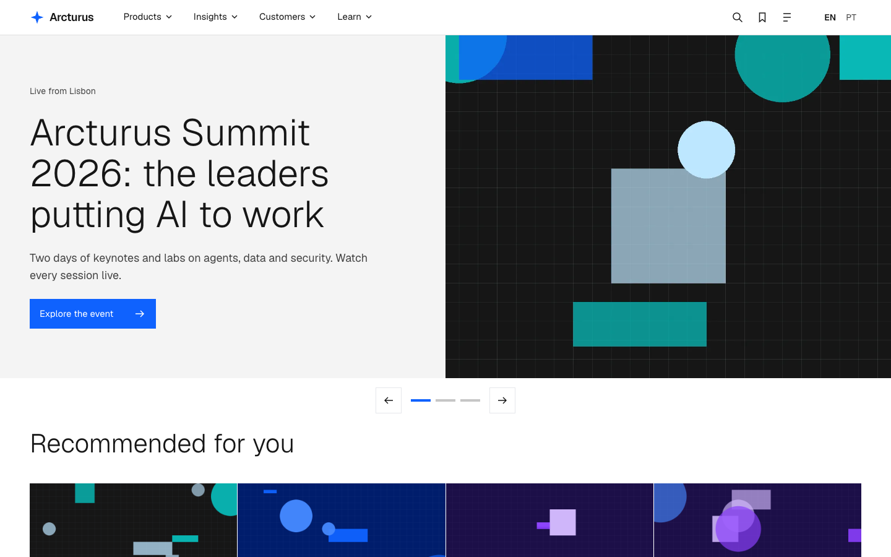
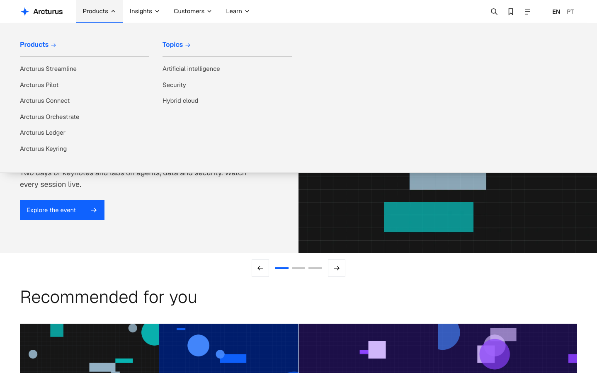
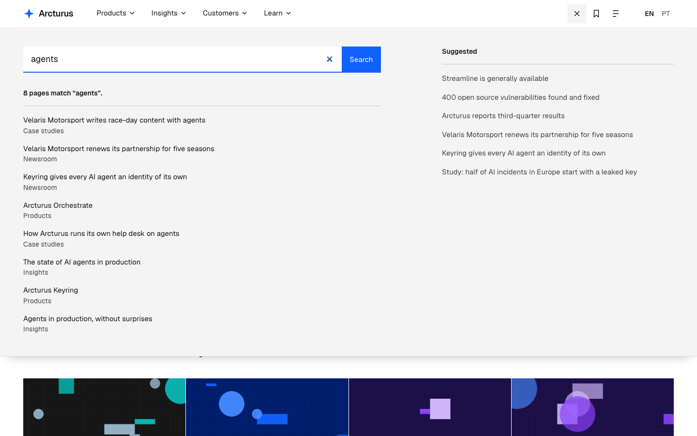
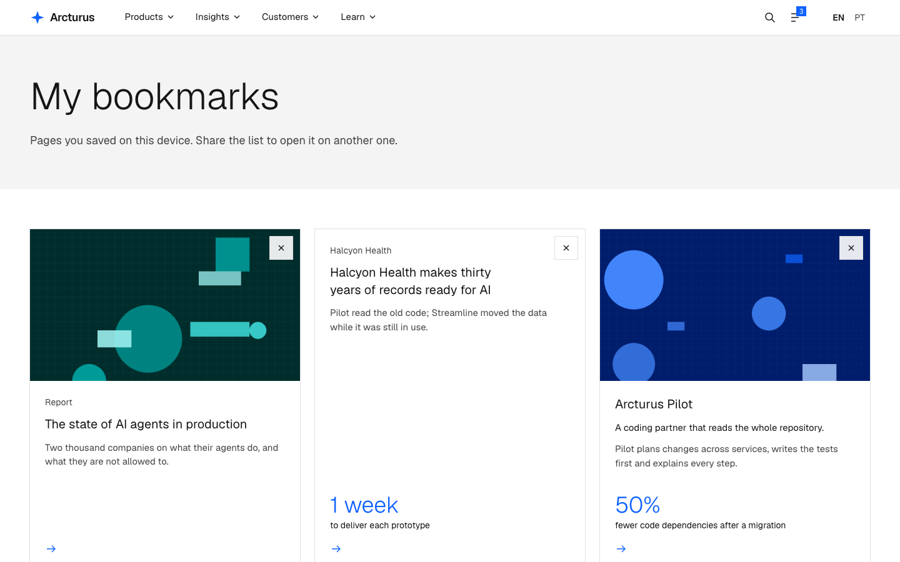
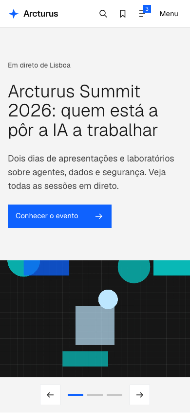
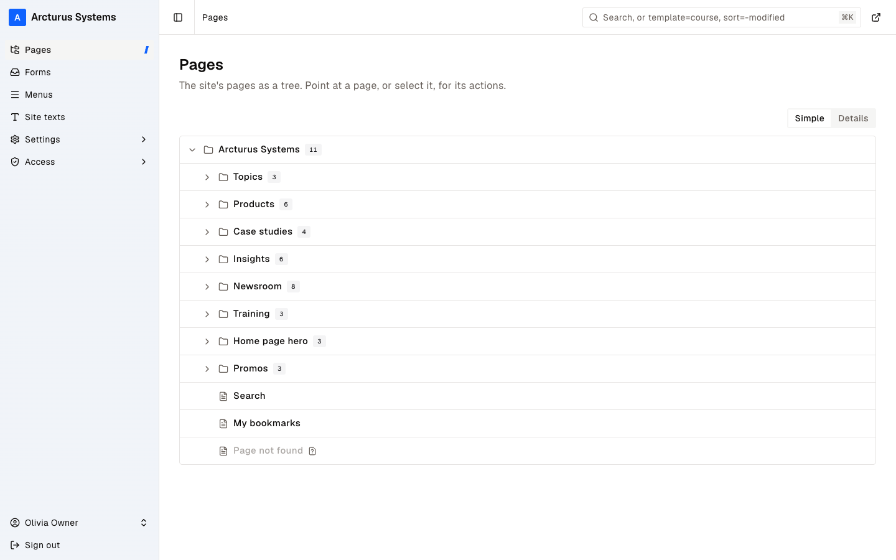
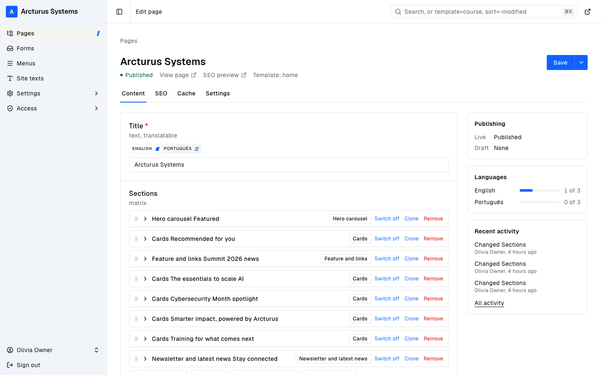
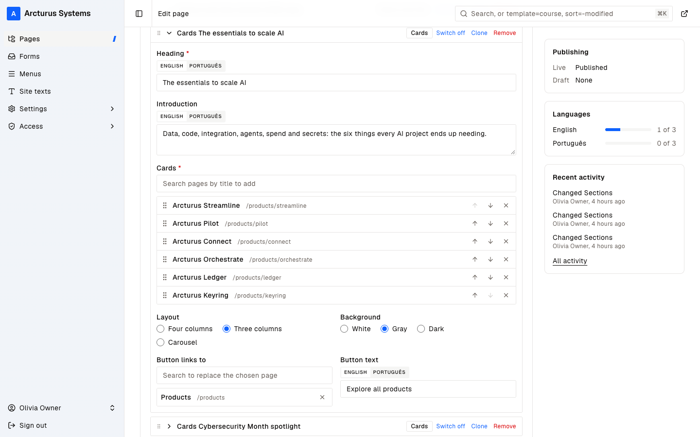
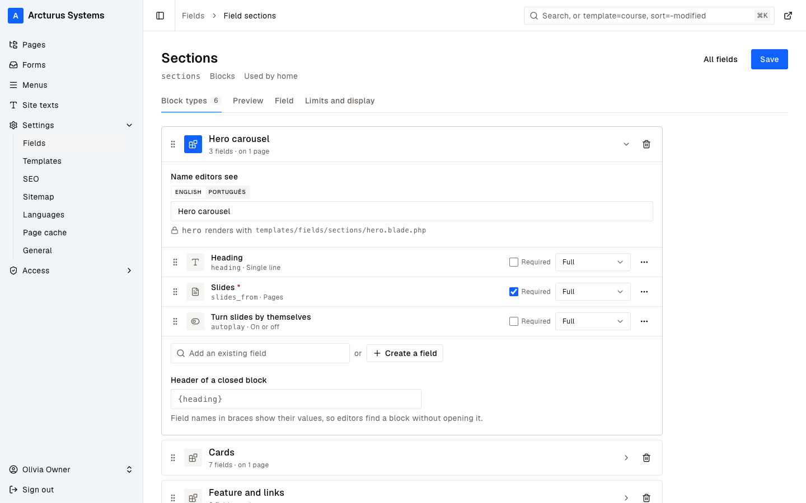

# Arcturus Systems, a corporate starter for Lynx

A corporate website built on [Lynx CMS](https://lynxcms.org/cms/docs/) and Laravel, in English and Portuguese. Editors arrange its home page from the admin, section by section, and pick the pages each section shows. It also has a mega-menu, a hero carousel, a search panel and bookmarks.

Install it to see how much of a Lynx site an editor can change without a developer, then read the code to see how. It takes about five minutes.



## What you can try

- Rearrange the home page. It's a list of sections: a hero, rows of cards, a feature with links, a newsletter. Drag them into another order, switch one off or add one, and reload the site.
- Change what a row of cards shows. Search for a product, a case study or a news item, add it, and drag it into place.
- Schedule the hero. Each slide is a page of its own, without a URL. One unpublishes itself two weeks after you install, and you can give any slide a time to go live or go offline.
- Search. Results show as you type, and beside them a list of suggestions that editors start and visitors fill in.
- Bookmark a few pages, then open **My bookmarks** and share the list.
- Switch to Portuguese at `/pt`. Take a page offline in Portuguese and watch the Portuguese home page drop it.

## Screenshots

### The site

| | |
| --- | --- |
|  |  |
| The mega-menu: each section lists its pages in columns. | The search panel, with results for "agents". |
|  |  |
| My bookmarks, kept in the browser. | The Portuguese home page on a phone. |

### The admin

| | |
| --- | --- |
|  |  |
| The page tree. Hero slides and promos live in branches of their own. | The home page's sections, ready to drag, switch off, clone or remove. |
|  |  |
| A Cards section: its pages in order, a layout and a background. | The section types, each rendered by its own Blade view. |

## What you need

- PHP 8.5, with the `gd`, `pdo_sqlite`, `mbstring` and `fileinfo` extensions. Most installs have them; `php -m` lists yours.
- [Composer](https://getcomposer.org/) 2.
- Node.js 20.19 or newer, or 22.12 or newer, to build the CSS and JavaScript.
- Git.

The data lives in SQLite, a database in a single file, so there's no database server to set up. On macOS or Windows, [Laravel Herd](https://herd.laravel.com/) installs PHP, Composer and Node in one go.

## Installing it

### 1. Get the code

```bash
git clone https://github.com/LynxCMS/lynx-corporate-starter.git arcturus
cd arcturus
```

### 2. Install the packages and the database

```bash
composer setup
```

This installs the PHP and JavaScript packages, creates `.env` (the site's settings) from `.env.example`, generates the app key, creates the SQLite database and its tables, links the folder that holds uploaded images, and builds the CSS and JavaScript.

### 3. Choose the owner's password

Open `.env` and set `OWNER_PASSWORD`. The default, `change-me-now`, is fine on your own computer and nowhere else.

### 4. Add the demo content

```bash
php artisan db:seed
```

This creates the owner account, installs Lynx, and adds the templates, the pages in both languages, the home page's sections, the menus and the search settings. It also draws an abstract picture for every page, so give it a few seconds.

### 5. Start it

```bash
composer dev
```

Open [http://localhost:8000](http://localhost:8000). `composer dev` keeps running in that terminal until you press `Ctrl+C`. If you only need the site, `php artisan serve` does the same job.

With Laravel Herd you can skip this step: Herd already serves the folder at `http://arcturus.test`. Set `APP_URL=http://arcturus.test` in `.env`, or the images will point at the wrong address.

## Signing in

The admin is at [http://localhost:8000/lynx](http://localhost:8000/lynx). Sign in as `owner@arcturus.example` with the password from `.env`. The owner is a superuser, so nothing is off limits.

A short tour:

1. In **Pages**, open the home page. Its **Sections** field lists the sections. Drag one, switch another off, press **Save** and reload the site.
2. Open a **Cards** section and change its pages, its layout (four columns, three columns or a carousel) or its background.
3. In **Pages**, open **Home page hero**. Each slide's **Settings** tab holds its schedule.
4. In **Pages**, open **Search**. Its **Suggested pages** come first in the search panel, in the order you drag them to, and **Pages in the search panel** sets how many show.
5. **Menus** holds the mega-menu and the footer.
6. **Site texts** holds the words around the pages that owners may change, such as the note in the footer.

## Starting over

```bash
php artisan migrate:fresh --seed
```

This deletes everything, your changes included, and adds the demo content again. Set `SITE_ARTWORK=false` in `.env` first if you'd rather not wait for the pictures.

## PostgreSQL and the page cache

To use PostgreSQL instead of SQLite, create a database. After step 2, set `DB_CONNECTION=pgsql`, `DB_HOST`, `DB_PORT`, `DB_DATABASE`, `DB_USERNAME` and `DB_PASSWORD` in `.env`, run `php artisan migrate`, and carry on with step 3.

The page cache stores guests' pages as HTML and sends them again without rendering them. It's off by default; set `LYNX_PAGE_CACHE=true` in `.env` to try it. The home page is kept for 15 minutes at most, because it lists the latest news, and signed-in editors always get a fresh page. [Page Cache](https://lynxcms.org/cms/docs/modules/page-cache) has the details.

## When something goes wrong

| What you see | What to do |
| --- | --- |
| `Set OWNER_PASSWORD in .env before seeding.` | Set `OWNER_PASSWORD` in `.env`, then run `php artisan db:seed` again. |
| Pages show without images | Run `php artisan storage:link`, and check that `APP_URL` in `.env` matches the address in your browser. |
| `Call to undefined function imagecreatetruecolor()` while seeding | PHP's `gd` extension is missing. Install it, or set `SITE_ARTWORK=false` and seed without pictures. |
| `Vite manifest not found` | Run `npm run build`, or keep `composer dev` running. |
| A change to a menu's Blade view doesn't show | Menus are cached as page parts. Run `php artisan cache:clear`. |
| `Your requirements could not be resolved` from Composer | Check `php -v`. Lynx needs PHP 8.5. |
| Port 8000 is taken | Run `php artisan serve --port=8080` and set `APP_URL=http://localhost:8080`. |

## How the home page is built

| Part | Where |
| --- | --- |
| The `sections` field and its section types | `database/seeders/SectionsSchemaSeeder.php` |
| One view per section type | `resources/views/templates/fields/sections/` |
| One card component for every template | `resources/views/components/card.blade.php` |
| Hero slides (`/homepage-hero/`) and promos (`/_promos/`), which have no URL | `database/seeders/SiteSchemaSeeder.php` |
| The mega-menu and the footer | `resources/views/menus/`, `database/seeders/SiteFeaturesSeeder.php` |
| The carousels' buttons, dots and autoplay | `resources/js/carousel.js` |

To add a kind of section, add a block type to the `sections` field (in `SectionsSchemaSeeder`, or in the admin) and a Blade view named after its slug in `templates/fields/sections`.

A row of cards is a page field: the editor picks the pages, and each card shows what its template has. Products and case studies get a figure, insights and promos their kind, news a date. Sections skip pages that are offline in the visitor's language, using Lynx's `publishedIn()`. Lynx itself would still list them, with a link to the English page.

The hero puts every slide in the HTML. That lets the page cache store the whole page, and the slides still scroll and snap without JavaScript.

## Search and bookmarks

The search panel shows the first eight matches as you type. Its suggestions start with the pages picked on the Search page, in their order. Then come the pages visitors opened most from search results lately, then the newest pages, until there are as many as the Search page asks for (`App\Search\Suggestions`).

The live results come in two versions, chosen with `SITE_SEARCH_PANEL` in `.env`:

- `javascript`, the default: `resources/js/search.js` fetches `/search/results` after a short pause, and cancels a request when you keep typing.
- `livewire`: the `App\Livewire\SearchPanel` component, its field bound with `wire:model.live`. It sits in a Lynx island, so a page in the page cache holds the plain search form and each visitor gets the component, in their language.

Both show the same results with the same view (`resources/views/search/live.blade.php`), and without JavaScript the form opens the Search page.

Opening a result sends a beacon to `/search/hit`. It counts once per visitor's address and page a day, and never for bots (`SearchHitController`). A visit adds `2^(days since the epoch / half-life)` to the page's score, so a week-old visit is worth half of today's, and sorting by score gives the ranking without touching old rows (`App\Search\Popularity`). The half-life is seven days; `SITE_POPULARITY_HALF_LIFE_DAYS` changes it.

Bookmarks live in the browser's localStorage, and the server stores nothing about them. **My bookmarks** (`/my-bookmarks`) asks `/bookmarks/cards` for the saved pages' cards in the visitor's language, and leaves out any they can't see. **Share this list** puts the list in a link (`?items=`) with a button to save it on the other end.

## Checks

```bash
php artisan test
vendor/bin/pint --test
vendor/bin/phpstan analyse
```

After changing fields, run `php artisan lynx:phpstan` to update `lynx/phpstan/types.php`.

## Learn more

- The [Lynx documentation](https://lynxcms.org/cms/docs/) covers templates and fields, selectors, languages, the admin and its modules.
- [Build a meeting rooms app](https://lynxcms.org/cms/docs/guides/meeting-rooms/) is the other starter, where Lynx is the base of an application.

## License

MIT. See [LICENSE](LICENSE). Arcturus Systems, its products, clients and figures are invented; any resemblance to a real company is a coincidence.
